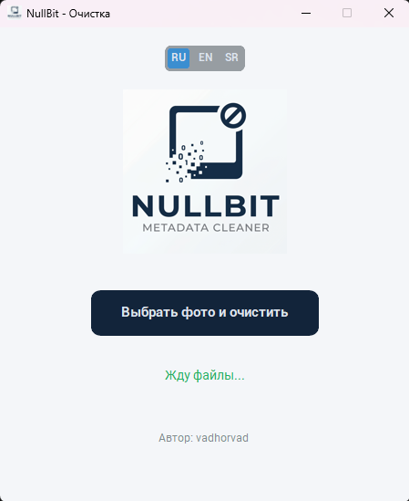

[🇷🇺 Русский](#-русский) | [🇬🇧 English](#-english) | [🇷🇸 Српски](#-српски)

---

# 🇷🇺 Русский

# 🧽 NullBit - Metadata Cleaner


**NullBit** — это легковесная и современная утилита с графическим интерфейсом для абсолютного удаления любых метаданных из фотографий и сгенерированных изображений.

Программа не просто стирает EXIF-теги, а физически переносит карту пикселей на новый виртуальный холст, что гарантированно уничтожает геолокацию, скрытые ICC-профили и вшитые промпты нейросетей (AI watermarks).



## ⚡ Особенности

- **Абсолютная очистка**: Удаляет данные на уровне пересборки пикселей, а не просто редактирует заголовки файла.
- **Пакетная обработка**: Выбирайте десятки файлов за один раз и сохраняйте их в нужную директорию.
- **Мультиязычность**: Поддержка Русского, Английского и Сербского языков "на лету" без перезагрузки.
- **Безопасность**: Программа никогда не перезаписывает оригиналы, создавая копии с постфиксом `_nullbit`.
- **Правильная ориентация**: EXIF-поворот «запекается» в пиксели перед очисткой — вертикальные фото не переворачиваются.
- **Устойчивость к ошибкам**: Повреждённый файл не останавливает пакетную обработку — он пропускается и учитывается в итоге.
- **Современный UI**: Минималистичный и приятный интерфейс на базе `customtkinter`.

## 📦 Установка и запуск

Вы можете скачать уже готовый скомпилированный `.exe` файл в разделе [Releases](https://github.com/vadhorvad/NullBit/releases) или запустить проект из исходного кода.

### Запуск из исходников

1. Склонируйте репозиторий:
```bash
git clone https://github.com/vadhorvad/NullBit.git
cd NullBit
```

2. Установите зависимости:
```bash
pip install -r requirements.txt
```

3. Запустите программу:
```bash
python nullbit.py
```

## 🛠 Сборка в .EXE

```bash
pip install pyinstaller
pyinstaller --noconsole --onefile --add-data "logo.jpg;." --add-data "favicon.ico;." --icon="favicon.ico" --collect-all customtkinter nullbit.py
```

## 👨‍💻 Автор
Создано **vadhorvad**.

---

# 🇬🇧 English

# 🧽 NullBit - Metadata Cleaner

**NullBit** is a lightweight and modern GUI utility designed for the absolute removal of all metadata from photos and generated images.

The program doesn't just erase EXIF tags; it physically transfers the pixel map onto a new virtual canvas. This guarantees the destruction of geolocation data, hidden ICC profiles, and embedded AI generation prompts (AI watermarks).

## ⚡ Features

- **Absolute Cleaning**: Deletes data at the pixel reassembly level, rather than just editing file headers.
- **Batch Processing**: Select dozens of files at once and save them to a specified directory.
- **Multilingual**: Supports English, Russian, and Serbian languages on the fly without restarting.
- **Safety**: The program never overwrites original files, creating copies with the `_nullbit` suffix instead.
- **Orientation-Safe**: The EXIF rotation is baked into the pixels before cleaning, so portrait photos never come out sideways.
- **Fault-Tolerant**: A corrupted file doesn't stop the batch — it is skipped and counted in the summary.
- **Modern UI**: Minimalistic and clean interface built on `customtkinter`.

## 📦 Installation & Usage

You can download the pre-compiled `.exe` file from the [Releases](https://github.com/vadhorvad/NullBit/releases) section or run the project from source.

### Running from source

1. Clone the repository:
```bash
git clone https://github.com/vadhorvad/NullBit.git
cd NullBit
```

2. Install dependencies:
```bash
pip install -r requirements.txt
```

3. Run the application:
```bash
python nullbit.py
```

## 🛠 Building to .EXE

```bash
pip install pyinstaller
pyinstaller --noconsole --onefile --add-data "logo.jpg;." --add-data "favicon.ico;." --icon="favicon.ico" --collect-all customtkinter nullbit.py
```

## 👨‍💻 Author
Created by **vadhorvad**.

---

# 🇷🇸 Српски

# 🧽 NullBit - Čistač metapodataka

**NullBit** je lagan i moderan uslužni program sa grafičkim interfejsom dizajniran za apsolutno uklanjanje svih metapodataka sa fotografija i generisanih slika.

Program ne briše samo EXIF oznake, već fizički prenosi mapu piksela na novo virtuelno platno. Ovo garantuje potpuno uništenje geolokacije, skrivenih ICC profila i ugrađenih uputstava veštačke inteligencije (AI vodeni žigovi).

## ⚡ Karakteristike

- **Apsolutno čišćenje**: Briše podatke na nivou ponovnog sklapanja piksela, a ne samo menjanjem zaglavlja fajla.
- **Grupna obrada**: Izaberite desetine fajlova odjednom i sačuvajte ih u izabrani folder.
- **Višejezičnost**: Podrška za srpski, engleski i ruski jezik u hodu, bez potrebe za ponovnim pokretanjem programa.
- **Bezbednost**: Program nikada ne prepisuje originale, već stvara kopije sa sufiksom `_nullbit`.
- **Bezbedna orijentacija**: EXIF rotacija se ugrađuje u piksele pre čišćenja, pa uspravne slike nikada ne izađu okrenute.
- **Otpornost na greške**: Oštećen fajl ne zaustavlja grupnu obradu — preskoči se i prebroji.
- **Moderan UI**: Minimalistički interfejs zasnovan na `customtkinter` biblioteci.

## 📦 Instalacija i pokretanje

Možete preuzeti već spreman, kompajliran `.exe` fajl u sekciji [Releases](https://github.com/vadhorvad/NullBit/releases) ili pokrenuti projekat iz izvornog koda.

### Pokretanje iz koda

1. Klonirajte repozitorijum:
```bash
git clone https://github.com/vadhorvad/NullBit.git
cd NullBit
```

2. Instalirajte zavisnosti:
```bash
pip install -r requirements.txt
```

3. Pokrenite program:
```bash
python nullbit.py
```

## 🛠 Kreiranje .EXE fajla

```bash
pip install pyinstaller
pyinstaller --noconsole --onefile --add-data "logo.jpg;." --add-data "favicon.ico;." --icon="favicon.ico" --collect-all customtkinter nullbit.py
```

## 👨‍💻 Autor
Kreirao **vadhorvad**.